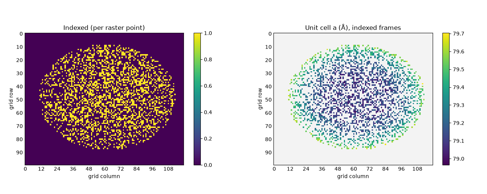
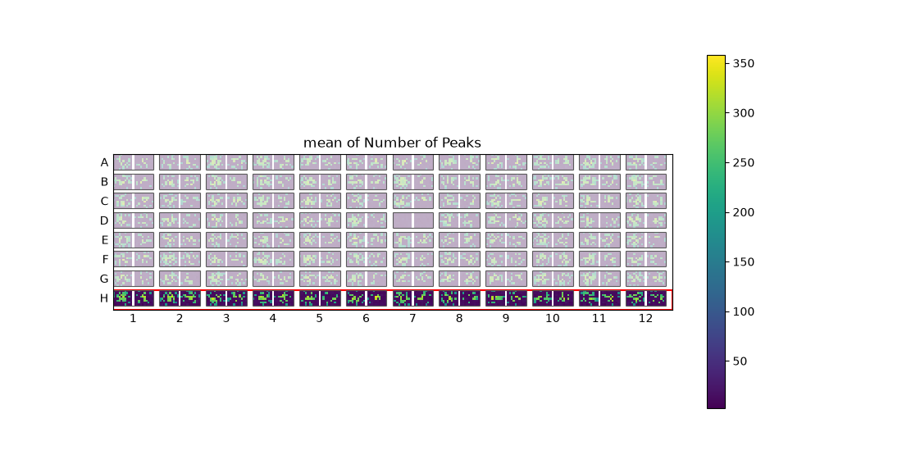

# DatView

DatView displays tables of per-frame and per-crystal statistics from serial crystallography and keeps a selection linked across every plot. Drag a range on one histogram and all other histograms, scatter plots, 2D histograms and plate maps redraw to show that subset. The selection can be saved as a CrystFEL stream, list or table, or merged directly with `process_hkl` or `partialator`.

Reference: N. Stander, P. Fromme & N. A. Zatsepin, *J. Appl. Cryst.* **52**, 1440–1448 (2019), [doi:10.1107/S1600576719012044](https://doi.org/10.1107/S1600576719012044).



## Requirements

Python ≥ 3.9 with:

```
pip install -r requirements.txt
```

`numpy scipy matplotlib h5py hdf5plugin lxml pyqtgraph PyQt5 pandas`. You need `hdf5plugin` to read bitshuffle/LZ4-compressed EIGER data. `pandas` is optional but makes loading large tables much faster. Two scripts have extra dependencies: `scripts/palxss.py` needs `tables`, and `scripts/venn3.py` needs `matplotlib-venn`. To use the merge function, CrystFEL (0.10 or later) must be on `PATH`.

## Quick start

```bash
git clone https://github.com/nzatsepin/DatViewCL.git
cd DatViewCL
pip install -r requirements.txt

# 1. Stream(s) -> table
python datgen.py -o run.dat run1.stream run2.stream

#    EIGER master metadata, stream header values, plate positions:
python datgen.py --eiger --headers --positions plate.csv -o run.dat run*.stream

# 2. Explore
python datview.py run.dat -g detector.geom

# 3. Without the GUI: select, export, merge
python datexport.py --filter good.xml run.dat good.stream
python datexport.py --filter good.xml --merge "process_hkl -y 2/m -o good.hkl" run.dat
python datplot.py -p "plate -c a --plate 96" -s plate_a.png run.dat
```

All scripts take `-h`.

## What is new (2026)

| | |
|---|---|
| **Memory and speed** | 5× less memory and interactive selections with any number of plots open: 1,000,000 rows, 12 histograms + 5 scatter plots: 0.5 GB vs 3.5 GB; a selection updates in 2 s vs 30 s. Closed plots are now freed. See [docs/UPDATE_2026.md](docs/UPDATE_2026.md). |
| **Merge without a stream file** | *File → Merge Selection* or `datexport.py --merge "..."` pipes the selected chunks straight into `process_hkl`/`partialator` (`-i -`). The output is byte-identical to merging an exported stream. |
| **CrystFEL 0.10–0.12 streams** | New fields: `serial`, `hit`, `ntries`, `pkres`, `uaxis`, `presid`. Byte-exact offsets. `--headers` adds every `--copy-header` value. |
| **EIGER / HDF5 master files** | `--eiger` adds detector distance, beam centre, count time, wavelength and ω from the master file. `--h5 PATH` adds any per-frame dataset. The item viewer reads frames through the `data_NNNNNN` links. `scripts/h5fields.py` lists usable fields. |
| **Plate / sample position plot** | Any column per well, drop and raster point of a 24- or 96-well plate (or a bare raster). Selections on the plate sync to all plots. See the [manual](docs/MANUAL_2026.md#4-sample-positions-and-the-plate-plot). MX3 scan notebooks: `scripts/mx3plate2positions.py` ([docs/MX3_SCAN_SCRIPTS.md](docs/MX3_SCAN_SCRIPTS.md)). |
| **Compatibility** | Python 3.9–3.13, numpy 2, matplotlib ≥ 3.9. Dat and filter files from 2019 still load. LCLS/CXI code paths kept unchanged. |



## Documentation

- [Manual (2026 additions)](docs/MANUAL_2026.md): installation, new options, sample positions, merging, troubleshooting
- [Tutorial and manual (2019)](https://zatsepinlab.atlassian.net/wiki/spaces/DAT/pages/827785219/Tutorial+2019): GUI, filters, partitions, groups and configuration are all unchanged
- [Update notes and benchmarks](docs/UPDATE_2026.md)
- [MX3 scan notebooks → position maps](docs/MX3_SCAN_SCRIPTS.md)
- [Changelog](CHANGELOG.md)

## Tests

```bash
pip install pytest
QT_QPA_PLATFORM=offscreen python -m pytest tests
```

The tests use small real CrystFEL 0.12 streams (`tests/data`). If `process_hkl` and `partialator` are on `PATH`, the merge tests also run them.

## Credits

Original written by Natasha Stander (Zatsepin lab, 2017–2019).

Updated in 2026 in Zatsepin lab, Swinburne University of Technology.

Includes a modified CfelPyUtils geometry parser and the histogram clip function of cxiview.
