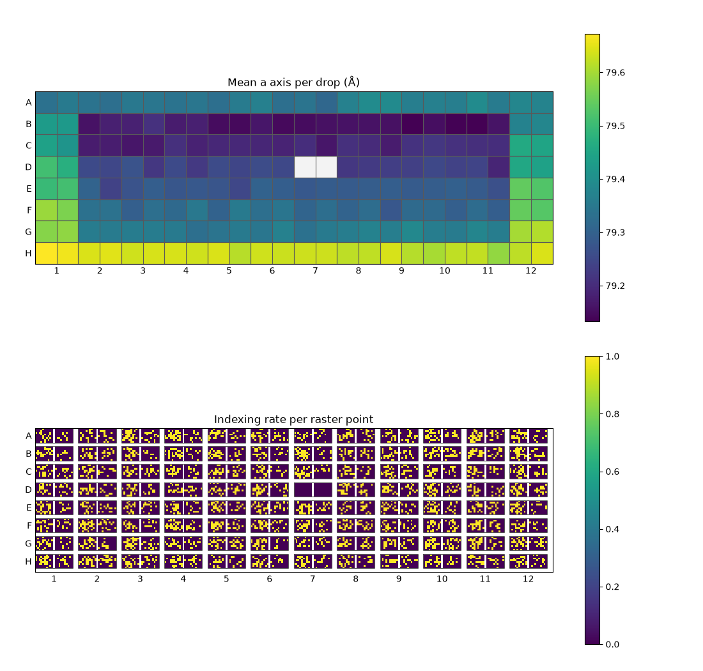

# DatView manual: 2026 additions

This supplements the 2019 [*DatView Manual and Tutorial*](DatView_Manual_and_Tutorial_2019.pdf). The GUI, filters, partitions, groups, XML configuration and scripts described there are unchanged unless this document says otherwise.

Contents

1. [Installation](#1-installation)
2. [datgen.py: new options and columns](#2-datgenpy-new-options-and-columns)
3. [EIGER / HDF5 master files](#3-eiger--hdf5-master-files)
4. [Sample positions and the plate plot](#4-sample-positions-and-the-plate-plot)
5. [Merging a selection without a stream file](#5-merging-a-selection-without-a-stream-file)
6. [Large datasets](#6-large-datasets)
7. [Changed behaviour and compatibility](#7-changed-behaviour-and-compatibility)
8. [Troubleshooting](#8-troubleshooting)

---

## 1. Installation

```bash
git clone https://github.com/nzatsepin/DatViewCL.git
cd DatViewCL
python3 -m venv ~/venvs/datview          # optional
source ~/venvs/datview/bin/activate
pip install -r requirements.txt
python datgen.py -h
```

- Python 3.9–3.13. Tested with numpy 2.5, matplotlib 3.11, PyQt5 5.15, pandas 3.1, h5py 3.16 and pyqtgraph 0.14 in a clean environment installed from `requirements.txt`.
- For merging, CrystFEL ≥ 0.10 must be on `PATH` in the shell DatView is started from. Tested with 0.12.0.
- Run `datview.py` locally or with X forwarding. If you only need the scripts (`datgen.py`, `datexport.py`, `datplot.py -s`), you can run them headless (`QT_QPA_PLATFORM=offscreen`).

## 2. datgen.py: new options and columns

```
datgen.py [-o OUT] [--eiger] [--h5 PATH ...] [--headers | --header NAME ...]
          [--positions TABLE | --grid NX NY [--serpentine]] [existing options] files...
```

| Option | Effect |
|---|---|
| `--h5 PATH` (alias of `--cxi`) | Adds an HDF5 dataset from each frame's image file as a column. Scalars apply to every frame. 1D arrays are indexed by event. Read once per file. A path missing from the file gives `-1`, with one warning. |
| `--eiger` | Adds the standard DECTRIS/NXmx paths: `detector_distance`, `beam_center_x/y`, `count_time`, `incident_wavelength`, `goniometer/omega`. |
| `--headers` | Adds a column for every `header/...` value in the stream, i.e. every field copied with `indexamajig --copy-header`. |
| `--header NAME` | Adds one such value. |
| `--positions TABLE` | Adds plate/drop/raster position columns from a table (§4). |
| `--grid NX NY` | Adds `grid_col`/`grid_row` from the event number, for frames collected as an NX × NY raster per file. Add `--serpentine` for snake scans. |

New built-in columns (CrystFEL 0.10–0.12 streams):

| Column | Stream line | |
|---|---|---|
| `serial` | `Image serial number` | |
| `hit` | `hit` | 1 if the peak search passed `--min-peaks` |
| `ntries` | `n_indexing_tries` | |
| `pkres` | `peak_resolution` | nm⁻¹ |
| `uaxis` | `unique_axis` | |
| `presid` | `predict_refine/final_residual` | |

The new columns are appended after the 2019 columns, so the column numbers in the 2019 manual still apply. Output column order: built-in, HDF5, static, concatenated, stream headers, positions, numpy file, group columns.

**Byte offsets.** Offsets are now byte positions measured in binary mode, so they are exact on every platform and with any file encoding. Peak and reflection offsets (`pstart/pend`, `rstart/rend`) point to the first data line and the end-of-list marker.

## 3. EIGER / HDF5 master files

**Indexing.** Use the master file in the indexamajig list. `list_events` (CrystFEL) or `scripts/listevents.py master.h5 -o frames.lst` expands it into one line per frame. Example geometry (single panel, EIGER native layout):

```
dim0 = %
dim1 = ss
dim2 = fs
data = /entry/data/data
```

**Metadata columns.**

```bash
python scripts/h5fields.py scan_0012_master.h5     # lists scalars and per-frame arrays
python datgen.py --eiger --h5 /entry/sample/goniometer/omega -o run.dat run.stream
```

Values copied into the stream at indexing time (`indexamajig --copy-header=/path`) are cheaper to read: use `--headers` instead.

**Item viewer.** The viewer reads frames from master files whose `/entry/data` holds `data_000001`, `data_000002`, … external links. The event number counts frames across the links in order. You need `hdf5plugin` for bitshuffle/LZ4 data. The data files must sit next to the master file, as the links are relative.

**Legacy LCLS/CXI.** The XTC/CXI paths, Cheetah file-name parsing (`run`, `class`, `subcxi`) and `/LCLS/...` fields are kept unchanged. They have not been retested against current LCLS formats.

## 4. Sample positions and the plate plot

### 4.1 What to record

Each frame needs: **which file and frame**, and **where on the sample it was collected**. DatView reads this from a positions table, one row per scan (or per frame), CSV or tab-separated:

| Column | Required | Meaning |
|---|---|---|
| `ifile` | yes | Image file of the scan (EIGER: the `_master.h5`). Matched by full path, then by file name, so the table still works after data are moved. |
| `event_start`, `event_end` | for several scans per file | First and last frame index (0-based, inclusive) of this scan in the file. Leave both empty if the whole file is one scan. |
| `event` | alternative | One row per frame. |
| `well` | plates | Well label, `A1` … `H12`. Row letter A = 1. Alternatively give `well_row` and `well_col` as numbers. |
| `drop` | plates with >1 drop | 1, 2, … |
| `grid_nx`, `grid_ny` | rasters | Points per line (fast axis) and number of lines. |
| `serpentine` | rasters | `yes` if alternate lines run in reverse. |
| `grid_col`, `grid_row` | alternative | Explicit raster indices, with one row per frame. |
| `step_x_um`, `step_y_um`, `x0_um`, `y0_um` | optional | Raster step and origin, giving `pos_x_um`/`pos_y_um` columns. |
| any other column | optional | Copied through, e.g. `plate`, `condition`, `humidity`, `time_open_min`. |

Raster convention: frame *k* of a scan (counting from `event_start`) is at line `k // grid_nx`. Its point is `k % grid_nx`, reversed on odd lines if `serpentine`. `grid_row` 0 is the first line collected. If your scan starts at a different corner, or runs along y first, the drop is drawn mirrored or transposed. Use explicit `grid_col`/`grid_row` columns in that case.

Example: two drops per well, 20 × 15 snake raster per drop, one master file per drop:

```csv
ifile,well,drop,grid_nx,grid_ny,serpentine,step_x_um,step_y_um,plate
plate1_A1_d1_master.h5,A1,1,20,15,yes,10,10,plate1
plate1_A1_d2_master.h5,A1,2,20,15,yes,10,10,plate1
plate1_A2_d1_master.h5,A2,1,20,15,yes,10,10,plate1
```

Example: several drops in one master file:

```csv
ifile,event_start,event_end,well,drop,grid_nx,grid_ny,serpentine
run7_master.h5,0,299,B3,1,20,15,yes
run7_master.h5,300,599,B3,2,20,15,yes
```

### 4.2 Writing the table at the beamline

**MX3 SSX notebooks:** `scripts/mx3plate2positions.py` converts the plate CSV and plate log that `SSXscanTools.py` already writes. See [MX3_SCAN_SCRIPTS.md](MX3_SCAN_SCRIPTS.md) for the steps, the checks to make, and the problems found in the current notebooks.

Other collection scripts:

The most reliable source is the grid-scan script itself, because it knows the well, drop, grid size and scan order when each scan starts. Add one call per scan at the end of the script:

```bash
python /path/to/DatView/scripts/makepositions.py -o /data/.../plate1_positions.csv \
    --ifile scan_0012_master.h5 --well B3 --drop 2 --grid 20 15 --serpentine --step 10 10 --plate plate1
```

From Python, append the same CSV row with `csv.DictWriter` (columns as in §4.1).

Check against one real scan that:

1. the master file name the script logs matches the `ifile` CrystFEL writes to the stream (`Image filename:`);
2. the frame order (start corner, fast axis, snake or not) matches the convention above. Lines along y take `fast_axis = y`;
3. scans split across several master files, or several drops written to one master file, are covered by `event_start`/`event_end`.

More positions-table columns: `fast_axis` (`x` default, `y` = lines along y), `grid_col_offset`/`grid_row_offset` (place a scan inside a larger map). `ifile` may contain wildcards (`*_12_master.h5`).

For a single raster without plate information: `datgen.py --grid NX NY [--serpentine]`.

### 4.3 Making the table

```bash
python datgen.py --positions plate1_positions.csv -o plate1.dat plate1_*.stream
python datview.py plate1.dat
```

Columns added: `well`, `well_row`, `well_col`, `drop`, `grid_col`, `grid_row`, plus `pos_x_um`/`pos_y_um` if steps were given, plus any extra columns. `well_row`, `well_col` and `drop` are categorical, so they can also be used as partitions.

### 4.4 The plate plot

*Plot → Plate / Sample Position Plot*:

- **Colour by**: any column (e.g. `npeak`, `a`, `reslim`, `multi`).
- **Statistic** per well, drop or raster point: mean, median, max, min, std, count, or *fraction > 0*. *Fraction > 0* on `multi` gives the indexing rate; on `hit` it gives the hit rate. Values of −1 (not measured, e.g. cell parameters of unindexed frames) are ignored, except by *count*.
- **Plate**: Auto (from the data), 24-well (4 × 6) or 96-well (8 × 12). **Drops per well**: Auto or 1–3.
- **Raster points**: on, each drop shows its raster; off, one value per drop.

Interaction is the same as in the other plots. Shift-drag to select wells or raster points: every other plot then shows only those frames. Selections on other plots dim the unselected data on the plate (*Draw both*). The colour scale is fixed to the full dataset, so colours stay comparable while the selection changes. Hover shows well, drop, grid point, value and number of frames. Empty drops are light grey.

From the command line:

```bash
python datplot.py -p "plate -c a --agg mean --plate 96 --noraster" \
                  -p "plate -c multi --agg 'fraction > 0' --plate 96" -r 2 -c 1 -s plate.png plate1.dat
```



*Synthetic data (`tests/make_plate_demo.py`): the a axis grows with collection order and at the plate edge (evaporation), the indexing rate is highest in the drop centres, and well D7 is empty.*

## 5. Merging a selection without a stream file

*File → Merge Selection (process_hkl / partialator)…* builds the command from the program, point group, output file and extra options. You can also edit the command directly. DatView sends the selected chunks on the program's standard input (`-i -`), and no stream file is written.

- The result is identical to exporting the selection as a stream and merging that file (checked with `process_hkl`).
- With an active partition, one merge runs per partition. The partition name is added to the output name: `merged_<name>.hkl`.
- Program output goes to the terminal DatView was started from. The dialog reports each exit code.
- Each selected crystal is sent as its own chunk (chunk header and peaks, then that crystal). Selecting one crystal of a multi-crystal frame merges only that crystal.

Command line:

```bash
python datexport.py --filter good.xml --merge "partialator -y 4/mmm -o good.hkl --model=unity --iterations=1" run.dat
python datexport.py --partition well --merge "process_hkl -y 4/mmm -o by_well.hkl" plate1.dat
```

## 6. Large datasets

- **Memory.** The loader keeps a single copy of the table. Text columns (file names, indexing method, well labels) are stored once per distinct value. Closing a plot window or unticking a histogram releases it. The status bar shows the process memory.
- **Scatter plots** with more points than `<scatterRasterThreshold>` (default 50,000, in the XML config) are drawn as an image at screen resolution. Each pixel shows the mean colour value of the points in it, and the image is re-binned after zoom or pan. Selection, zoom and tooltips are unchanged. Set the threshold very high to always draw individual markers.
- **Hidden plots** do not redraw. They update when shown.
- **Reloading.** *Save Numpy* (`.npz`) reloads faster than the `.dat` file.

Measured on 1,000,000 rows (2-core VM), 12 histograms open, then 5 scatter plots opened and closed: memory 0.55 GB vs 2.9–3.5 GB (2019), selection update 0.8–2.0 s vs 1.3–32 s. Details: [UPDATE_2026.md](UPDATE_2026.md).

## 7. Changed behaviour and compatibility

- 2019 `.dat`, `.npz`, filter, group and XML config files load as before.
- `.npz` files saved now no longer contain a second raw copy of the table. Only columns altered on load (`mult`, `invert`) keep their original values.
- Exported `.dat` files reproduce the input values (`aclen` was previously truncated to an integer, and the orientation matrix lost precision).
- *OR* filters in saved filter files load correctly (previously an exception).
- Histograms are drawn as one filled step outline per stack instead of one rectangle per bin. The counts are identical.
- `datplot.py -s` works without a display. It has a new `plate` plot type.
- PyQt4 import fallbacks remain but are untested.

## 8. Troubleshooting

| Symptom | Cause / fix |
|---|---|
| `OSError: Can't read data (can't open directory)` / blank frames in the viewer | `hdf5plugin` missing, or EIGER data files not next to the master file. |
| `'process_hkl' was not found on PATH` | Start DatView from a shell where CrystFEL is set up. |
| Plate plot menu greyed out | The table has no `well_row`/`well_col` or `grid_col`/`grid_row` columns. Rerun datgen with `--positions` or `--grid`. |
| Plate rows empty after `--positions` | `ifile` in the table does not match the stream's `Image filename` (neither full path nor file name), or the event ranges do not cover the frames. |
| Drop drawn mirrored or transposed | Scan order differs from the convention in §4.1. Give `grid_col`/`grid_row` per frame. |
| Column missing with `--h5` | Path not in that file (one warning per path). `scripts/h5fields.py` lists the paths present. |
