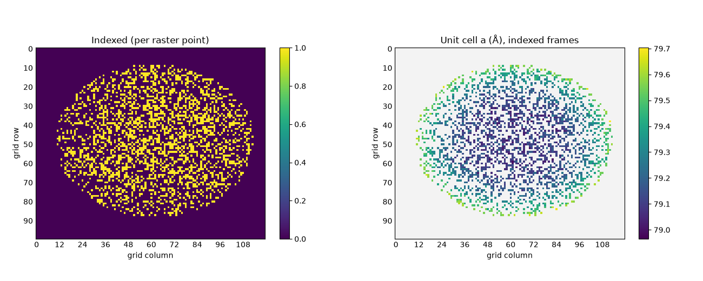

# MX3 SSX scan notebooks → DatView position maps

Covers `SSX_GridScans.ipynb`, `SSX_PlateScanb.ipynb`, `SSXscanTools.py` and `plate_alignment.ipynb` (versions of 2026-04 to 2026-06).

## 1. Workflow

The notebooks already write the information DatView needs to `<SAMPLENAME>_plate_csv.txt` (one row per scan) and `<SAMPLENAME>_plate_log.txt` (the prefect parameters of each scan).

```bash
python scripts/mx3plate2positions.py \
    --csv  .../sbig-filtered-0-22/sbig-filtered-0-22_plate_csv.txt \
    --log  .../sbig-filtered-0-22/sbig-filtered-0-22_plate_log.txt \
    --masters .../sbig-filtered-0-22/grid_scans \
    -o sbig_positions.csv
python datgen.py --positions sbig_positions.csv -o sbig.dat sbig*.stream
python datview.py sbig.dat          # Plot → Plate / Sample Position Plot
```

What the converter takes from each source:

| DatView | Source |
|---|---|
| image file | `Scan Counter` matched to `grid_scans/*_<counter>_master.h5`, the same rule `get_current_counter()` uses. Without `--masters`, the pattern `*_<counter>_master.h5` is written instead. |
| frames → grid point | `number_of_rows`, `number_of_columns` from the log (or `--grid-size`). Frame *k* of a scan → column `k // rows`, row `k % rows` (`--fast-axis y`, the default). |
| well, drop | `Window Name` if it is a well label (`A1`, or `A1 well 2`). Otherwise `--drop`. |
| map of a window | Scans of one window are tiled by their motor positions (`scan x` → scan column, `scan y` → scan row). Each scan occupies `columns × rows` cells. |
| physical position (`pos_x_um`, `pos_y_um`) | Distance from the window's first scan: `scan x/y` (mm) plus grid point × step. |
| step | `--step DX DY` (µm), or `grid_width/columns` and `grid_height/rows` (camera px) ÷ 513 px/mm. 513 px/mm comes from `ImageAnalysis` in the plate-alignment notebook; it gives 20.5 × 20.3 µm for the GridScans settings (designed as 20 µm). Use `--step 20 20` when the step is known. |
| extra columns | `scan_counter`, `window`, `scan_row`, `scan_col`, `scan_x_mm`, `scan_y_mm`, `plate`, `energy_keV`, `det_dist_m`, `transmission`. Also `flux` and beam size once the csv has them (§3). |

Example (synthetic data on the GridScans layout, 2 × 12 scans of 50 × 10 points, run through the converter):



## 2. Check before relying on the maps

1. **Frame order within a scan.** I could not check this from the notebooks: the raster is done by the prefect flow `mxcube-grid-scan/plans`. The default assumes one vertical line per grid column (the MD3 moves `alignment_y` at `md3_alignment_y_speed`), all lines in the same direction. If lines alternate in direction, add `--serpentine`. If lines are horizontal, use `--fast-axis x`. Test: plot `npeak` for one scan across a drop edge. A wrong setting shows as a comb pattern along the edge in alternate columns. Rerun the converter with the other setting and compare.
2. **Direction of columns and rows.** Columns are assumed to advance towards decreasing horizontal motor position, as the scans do (`tlx = … - i*column_spacing`), and rows towards increasing vertical position. If a drop appears mirrored compared with the microscope image, use `--flip-x` or `--flip-y`.
3. **File names.** The stream's `Image filename:` must match the master file names found by `--masters`, by full path or by file name.

## 3. Issues found in the notebooks

These affect the positions recorded, not only DatView.

| # | Where | Problem | Effect |
|---|---|---|---|
| 1 | PlateScanb, collection cell | `for scan in ssr.scanList:` loops over the scans of the **last** window built (`ssr`), not those of `key` | With several windows (`wlist = ["A1","A2","B1"]`), every pass moves to B1's positions. The csv records them under A1, A2, B1. |
| 2 | PlateScanb, collection cell | `append_scan_info_to_plate_csvfile(..., scans_completed, ...)`: `scans_completed` keeps counting across windows but is used as an index into one window's `scanList` | `IndexError` at the first scan of the second window |
| 3 | PlateScanb, window cell | `SSRparams['top_left'] = []`; the csv writer reads `params['top_left'][0]` | `IndexError` at the first csv write: no csv row is ever written |
| 4 | PlateScanb, parameter cell | `beam_x_size = = …`, `beam_y_size = = …`, `dmmstripe = = …`; missing comma after `'y_speed' : …` in `plateParams` and `beamParams`; `EpicsSignalRO` not imported | Cell does not run (the saved outputs come from an earlier version) |
| 5 | PlateScanb | Scan rows offset by `j*SSRparams["row_spacing"]` with `row_spacing = 10` (mm). GridScans uses `j*1.0` (50 rows × 20 µm). | Second row of scans 10 mm away, i.e. in another well. Please confirm which was intended. |
| 6 | GridScans, end of collection cell | A bare `prefect_client.trigger_grid_scan()` after the loop | One extra scan at the last position, with no csv/log entry. DatView leaves those frames without position. |
| 7 | both | `move_to_well_spot(f"{wind} well 1", …)`: spot fixed at 1 and not written to the csv | Drops 2–4 of a well cannot be distinguished later |
| 8 | SSXscanTools | The csv has no grid rows/columns, grid size, spot, flux, transmission or beam size; `beamParams` extras are not written | Needs the log for the grid size; flux etc. lost |

### Suggested changes

`SSXscanTools.py`: extend the plate csv. New columns go at the end, so existing csv readers keep working.

```python
    def open_plate_csvfile( self, csvname ):
        self.csvname = csvname
        with open( csvname, 'w') as f:
            filewriter = csv.writer(f)
            header = ['ScanID', 'Plate Name', 'Beam Energy', 'detector z', 'y speed', 'Window Name', 'window x', 'window y']
            header += ['Scan Counter', 'scan row', 'scan col', 'scan x', 'scan y']
            header += ['spot', 'number_of_rows', 'number_of_columns', 'grid_width', 'grid_height',
                       'transmission', 'flux', 'beam_x_size', 'beam_y_size']
            filewriter.writerow(header)

    def append_scan_info_to_plate_csvfile( self, csvname, ssrName, scanCounter, index, beamParams, spot=1 ):
        region = self.scanRegionList[ssrName]
        scan = region.scanList[index]
        top_left = region.params.get('top_left') or [scan.horizontal, scan.vertical]
        p = scan.prefect_parameters
        with open( csvname, 'a') as f:
            filewriter = csv.writer(f)
            row = [self.scanID, self.plateName, beamParams['photon_energy'], beamParams['detector_distance'],
                   beamParams['y_speed'], ssrName, top_left[0], top_left[1]]
            row += [scanCounter, scan.ssr_row, scan.ssr_col, scan.horizontal, scan.vertical]
            row += [spot, p['number_of_rows'], p['number_of_columns'], p['grid_width'], p['grid_height'],
                    beamParams.get('transmission', p.get('transmission')), beamParams.get('flux', ''),
                    beamParams.get('beam_x_size', ''), beamParams.get('beam_y_size', '')]
            filewriter.writerow(row)
```

Collection loop (both notebooks), fixing issues 1, 2 and 7:

```python
counter = get_current_counter(samplepath)
SPOT = 1                                   # the spot passed to move_to_well_spot
for key, region in plate.scanRegionList.items():
    region.write_scan_region_parameters_to_log_file(logname, counter)
    for idx, scan in enumerate(region.scanList):
        horizontal.set(scan.horizontal)
        vertical.set(scan.vertical)
        time.sleep(3)
        MX3SyncPrefectClient(name="mxcube-grid-scan/plans", parameters=scan.prefect_parameters).trigger_grid_scan()
        scan.write_scan_parameters_to_log_file(logname, counter)
        plate.append_scan_info_to_plate_csvfile(csvname, key, counter, idx, beamParams, spot=SPOT)
        counter += 1
```

With the patched csv the converter does not need the log. It reads `spot`, the grid size, `transmission`, `flux` and the beam size directly.
