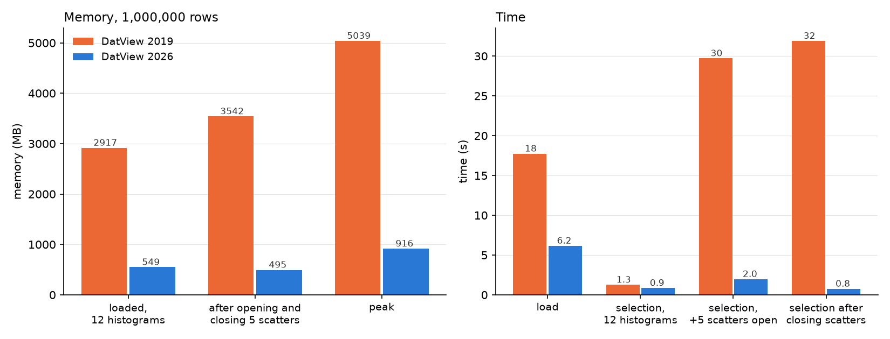

# DatView 2026 update: changes, verification, benchmarks

## 1. Why DatView became slow

Before the update, memory use and selection time grew with every plot ever opened:

- **Closed plots never went away.** Each plot connected to the data model's selection signals and never disconnected. A closed scatter window, or an unticked histogram (it was only hidden), kept its figure and its data. It also kept redrawing on every selection. After 5 scatter plots were opened and closed, each selection still redrew all of them: 30 s per selection at 10⁶ rows.
- **The table was held twice.** `rdata` (as read, including fixed-width unicode copies of every file path) and `data` (converted) were both kept in memory. 2.9 GB at 10⁶ rows.
- **Every selection change copied the selected rows** (`filtered`), although plots only need a boolean mask.
- **One matplotlib rectangle per histogram bin, per stack**, rebuilt on every redraw. Scatter plots drew every point as a vector marker.

## 2. What changed

### Data model (`api/datamodel.py`)
- Single in-memory table. String columns stored as integer codes plus one label array. pandas' C parser reads text columns directly as categories. Freed parser memory is returned to the OS (glibc `malloc_trim`).
- Only columns modified on load (`mult`, `invert`) keep their raw values, so dat export is exact.
- Lazy `filtered`. Selection counts are cached.
- Stream export, list export and peak/reflection reading use binary I/O with byte offsets (`api/streamio.py`).
- `pipeSelStream` / `mergeByPartitions`: the selection is piped to `process_hkl`/`partialator`.
- Fixed: *OR* filters in filter files raised an exception. `aclen` was exported as an integer. Orientation-matrix components were exported to 6 decimals.

### Plots (`ui/plots.py`, `datview.py`)
- Every plot records its model connections and disconnects them when its window closes (`WA_DeleteOnClose`) or its histogram is unticked. The figure is cleared and the widget deleted.
- Redraws are coalesced: one per event-loop pass, however many model signals fired. Hidden plots only mark themselves stale.
- Histograms: counts from `numpy.histogram`, one `stairs` patch per stack.
- Scatter plots above `scatterRasterThreshold` points are drawn as a view-binned image (mean colour per screen bin), re-binned on zoom/pan.
- Status bar memory readout.
- matplotlib ≥ 3.9 (`get_cmap`, `savefig(format=)`), numpy 2 (removed aliases in the bundled geometry/cxiview code).

### New
- `ui/plateplot.py`: plate / sample-position plot (24/96-well, drops, rasters). Its selections act as filters and sync with all plots.
- `ui/mergeDialog.py`: merge dialog.
- `api/positions.py`, `scripts/makepositions.py`: position tables.
- `scripts/h5fields.py`: lists the per-frame metadata in an HDF5/EIGER master file.
- `scripts/listevents.py`: rewritten. Counts frames through EIGER `data_NNNNNN` links.
- `datgen.py`: rewritten parser. CrystFEL 0.10–0.12 fields, `--eiger`, `--h5`, `--headers`, `--positions`, `--grid`. All options documented in `-h`. 2019 column order preserved.
- `datexport.py --merge`, `datplot.py` `plate` plot type, and off-screen saving fixed.
- `tests/`: 16 tests, run on real CrystFEL 0.12 streams.

## 3. Verification

| Check | Result |
|---|---|
| Unit/integration tests (`pytest tests`) | 16/16 pass. Clean venv from `requirements.txt`: numpy 2.5.5, matplotlib 3.11.2, PyQt5 5.15.11, pandas 3.1.1, h5py 3.16.0, pyqtgraph 0.14.0. |
| Stream source | CrystFEL 0.12.0 built from source. `indexamajig` (asdf, zaef, `--multi`, `--copy-header`) run on simulated EIGER-layout bitshuffle data: 60 frames, blank, single- and two-lattice frames. |
| datgen vs 2019 datgen on the same streams | Identical values in all 47 common columns, byte offsets included (66 rows). |
| Offsets | Every `istart/iend/cstart/cend/pstart/pend/rstart/rend` points to the expected marker. |
| Dat round trip (load → export) | All columns equal within print precision. `.npz` round trip identical. |
| Stream export | Valid stream. One chunk per selected row. Merges with `process_hkl`. |
| Direct merge | `process_hkl` output via pipe identical to output from the exported stream file. `partialator -i -` reads the same crystals as from the file. Merged-output comparison was not possible for partialator: it rejected all simulated crystals at its profile-radius check. |
| Item viewer | Opens frames from the simulated EIGER master via external links. Peaks and reflections overlay at the stream positions. |
| Plot lifecycle | After opening and closing scatter, 2D histogram and plate windows, the number of model listeners returns to baseline. Unticked histograms are destroyed. |
| Not tested | Real MX3 streams and master files; PyQt4; macOS display. The legacy LCLS paths were not retested. |

## 4. Benchmarks

Synthetic tables were built by replicating rows of the real 0.12 streams. Each has 47 columns (the 2019 column set) and 1,000 distinct file paths per 10⁶ rows. Both versions ran headless (Qt offscreen) on the same 2-vCPU, 7.6 GB Linux VM. The 2019 code needed two compatibility shims to run on current numpy/matplotlib (`np.lib.npyio.asstr`, `plt.cm.get_cmap`). Memory is resident memory above the post-import baseline. Times include redrawing all open plots. Script: `tests/benchmark.py`. Raw results: `docs/benchmarks/`.

Steps: load the table in the main window with 12 histograms → select a range of `reslim` → open 5 scatter windows → select → close the scatter windows → select.

| 10⁶ rows | 2019 | 2026 |
|---|---|---|
| Load | 17.7 s | 6.2 s |
| Memory, 12 histograms | 2,917 MB | 549 MB |
| Memory after 5 scatters opened and closed | 3,542 MB | 495 MB |
| Peak memory | 5,039 MB | 916 MB |
| Selection, 12 histograms | 1.3 s | 0.9 s |
| Selection, + 5 scatters open | 29.7 s | 2.0 s |
| Selection after closing them | 31.9 s | 0.8 s |

| 2×10⁵ rows | 2019 | 2026 |
|---|---|---|
| Load | 4.1 s | 1.9 s |
| Memory, 12 histograms | 657 MB | 135 MB |

Absolute times depend on the display and CPU. The ratios, and memory returning after windows close, are the robust results.

## 5. Options considered and not taken

- **Polars / DuckDB.** The interactive cost was the plotting and the plots that were never released, not the table operations. Boolean-mask filtering of numpy columns already takes milliseconds at 10⁶ rows. The structured numpy table was kept, so filters, groups, partitions, `.npz` files and every script work unchanged. pandas is used only for parsing.
- **Julia rewrite.** It would mean rewriting the GUI, the configuration system and the scripts, for no gain on these bottlenecks.
- **Keeping only some columns in memory.** At 10⁶ rows the full numeric table takes about 0.2 GB. Stream byte offsets are stored per row, so stream and merge export work for any selection without the stream text being in memory.

## 6. Known limitations / next steps

- Test on MX3 streams and master files, and on the grid-scan scripts (MANUAL §4.2 checklist).
- Selections drawn on the plate plot are not restored from saved filter files without that plot open.
- Merging runs in the GUI thread, with a progress dialog and abort. A large merge blocks other interaction until the input has been sent.
- Event IDs other than a single integer (`//N`) are stored as `event = -1`.
