# DatView tutorial

Written by Natasha Stander for DatView 2019. It was first published on the Zatsepin lab Confluence site and later in the [2019 manual and tutorial (PDF)](../DatView_Manual_and_Tutorial_2019.pdf).

The text is unchanged except for the installation section, the command lines (now shown as text) and links to the current documentation. The screenshots are from the 2019 version. The GUI, plots, filters and control panel work as shown. Differences in the 2026 version:

- Histograms are drawn as step outlines. The counts are the same.
- Large scatter plots are drawn as an image. Selection, zoom and tooltips work as before.
- New: the plate / sample-position plot and *File → Merge Selection*. See the [2026 manual](../MANUAL_2026.md).

Contents

1. [Installation](#installation)
2. [DatView](#datview)
3. [Item Viewer](#item-viewer)
4. [Control Panel](#control-panel)
5. [Plots](#plots)
6. [Comparison Mode](#comparison-mode)

---

## Installation

DatView is written in Python 3. Install it with:

```bash
git clone https://github.com/nzatsepin/DatViewCL.git
cd DatViewCL
pip install -r requirements.txt
```

Requirements and options are in the [2026 manual](../MANUAL_2026.md#1-installation). DatView also uses the geometry file parser from cfelpyutils and the histogram clip function of cxiview, both shipped with DatView.

This tutorial focuses on SFX data analysis, but DatView can be used for other input types. See *Configuration Files* in the [2019 manual](../DatView_Manual_and_Tutorial_2019.pdf) for how the data types of columns are determined.

## DatView

The first step to using DatView is a preprocessing step that creates a table from input files (see `datgen.py` in the [2019 manual](../DatView_Manual_and_Tutorial_2019.pdf) and the [2026 manual](../MANUAL_2026.md#2-datgenpy-new-options-and-columns) for more details and options for creating input). For this tutorial, the data come from [CXIDB entry 40](https://www.cxidb.org/id-40.html) and stream files were regenerated with CrystFEL.

```bash
# Two stream files in the folder: 137to144.stream000 and 137to144.stream001
# ? matches multiple stream files
python datgen.py -o 137to144-jan19.dat 137to144.stream00?   # data generator script
python datview.py 137to144-jan19.dat &                       # viewer script
```

This opens up the graphical user interface:

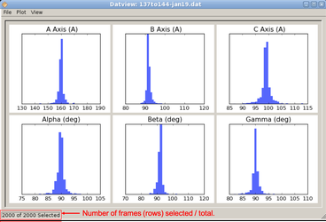

If the graphical user interface fails to open, first check if the file paths to the image or stream files contain spaces. If so, you must use a group file to replace the paths, because the space separation in the file names made an additional column in the output. Basic instructions on group files are in *Group Files* in the [2019 manual](../DatView_Manual_and_Tutorial_2019.pdf), and you will need to rerun both steps with the `--group` argument. Another possibility is that the configuration file is incorrect. DatView has not been tested on Windows, but if you are using Windows then the symbolic link to the `crystfelcfg.xml` file will have been lost and you will need to fix it as described in *Configuration Files* in the [2019 manual](../DatView_Manual_and_Tutorial_2019.pdf).

Once you have an open GUI, you can create additional histograms from any parameter present in the dat file:

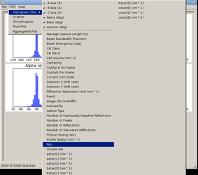

And new histograms appear on new rows, 3 per row (setting can be changed in configuration files):

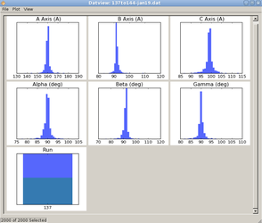

If you look closely, you might notice that the "Run" histogram has two different shades of blue. In fact, you may be wondering, what's with the blue anyway? Under *View → Controls*, you can access the control panel:

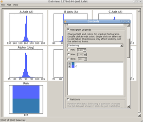

And you can see the histograms are stacked by the "Centering" and the brighter blue is "C" centered and the darker blue is "-". In this case "-" means not indexed. The colors to use for centering are specified in the configuration files to match cell_explorer coloring, but since "-" isn't specified, it goes to the first available default color (also given in the configuration file and by default is matplotlib's color scheme). To make things more interesting, try stacking the histograms by the indexing method:

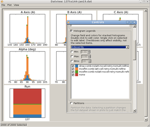

While it's convenient with the control panel right there, it's often useful to have the legend actually on the plot. So, right click on the first plot to add a legend:

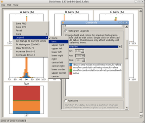

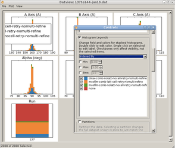

Yikes, that's too big and now the plot is not at all helpful. Well, it would be convenient if you could shorten the legend names. Do this by selecting a name and clicking. This lets you edit the text (which only changes labeling, not the underlying data):

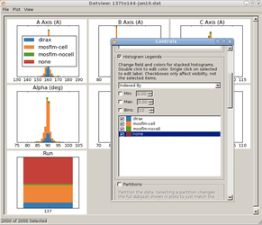

Cool so far, but it turns out that red just isn't the color you want for the non-indexed patterns. So, let's change the color by double clicking on the entry:

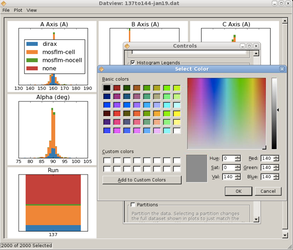

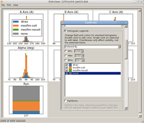

Awesome! What else can you do with histograms? Well, perhaps you want to know how many are actually in each bin since the y-axes are hidden (to match cell_explorer). You can get lots of helpful information from any plot using the tooltip on hover:

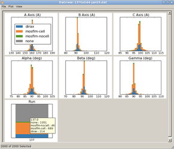

And, you can make selections on any plot with shift+click and drag (shown shaded transparent red) that are synced across all plots:

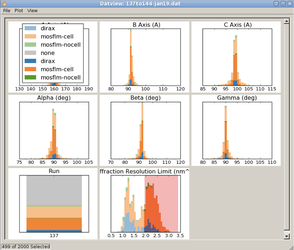

So far, you've explored features related to CrystFEL's cell_explorer. But DatView also has most of the features of cxiview.

## Item Viewer

Open the Item Viewer from the *View → Item Viewer* menu:

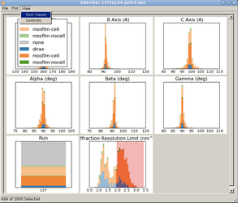

You now have two windows:

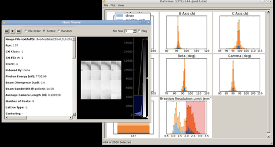

The item viewer displays the list of attributes for a pattern on the left, and the associated frame on the right. (Check out configuration files for some options on the types of data you can display on the right.) But, you quickly notice that the display matches the raw file format instead of the physical detector. You'd like to display the data according to your CrystFEL geometry file. You can pass this file on the command line with `--geom`, but no fear. You can load it from the GUI right click menu as well:

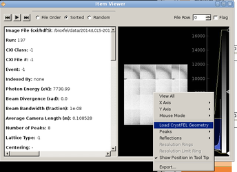

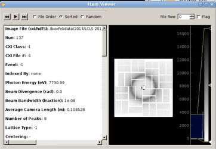

That looks like a normal frame now. But, as you can see from the side bar, this particular frame wasn't indexable. Let's get to an indexed frame. At the top, you have previous, play, and next buttons to navigate with, as well as options on how to order the frames. Try clicking next:

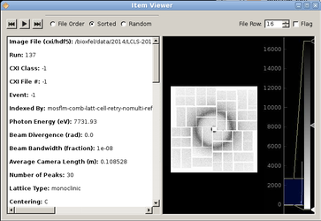

Clicking next in this case is going to jump to the 16th (17th from 0 based counting) row of the file (you can see the file row in the spin box at the top right) because there is currently a selection in the histograms (remember the first picture on this page?). Making a selection will not update the current frame in the item viewer (think about the disaster if you select nothing), but it will ensure that any frame you navigate to with previous/play/next will match the current selection. You can jump to frames that don't match the selection by typing in the file row spin box in the top right.

Now that we have an indexed frame, let's start adding some of the features available from the right click menu:

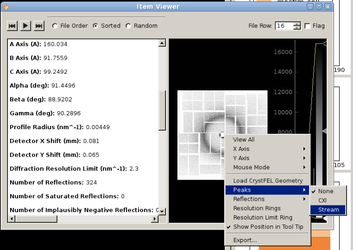

Peaks:

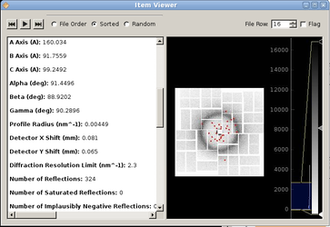

Reflections:

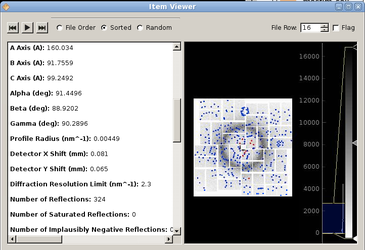

Resolution rings:

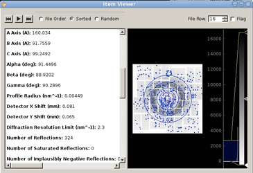

And the diffraction resolution limit ring:

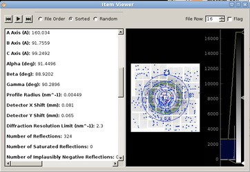

Aspects of all these features such as color, size, and which resolution rings to draw are all configurable in the configuration file. The interactivity of this plot is the same as for histograms (and all other plots) with scroll for zoom, left click and drag for pan, and tool tips for detailed information on particular features:

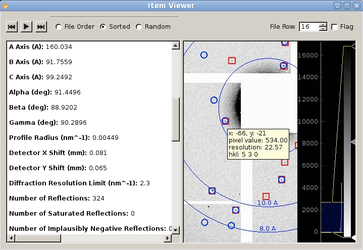

Note that the resolution is only available if a geometry file is loaded, and the HKL value is only shown if reflections are being displayed and the mouse is within the circle drawn for that particular HKL value.

What if you click next again? You already know that the next pattern will match the current selection, but the order radio buttons also say sorted. The initial sort is file order, so clicking next would take us to frame 17 which happens to match, but let's instead change the sort order from the control panel:

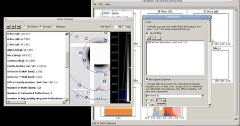

Now, the next pattern will be one with an equal or larger diffraction resolution limit, in this case, 377:

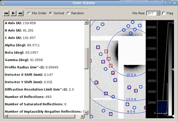

If you decide you don't like the sorting, you can follow the file order at the top. Use the spin box to jump to frame 16:

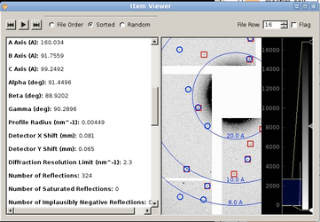

Change the order to file order:

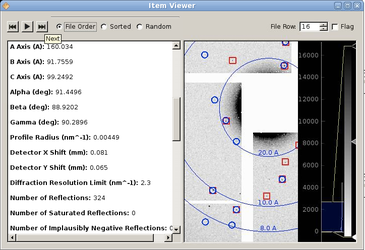

And the next image will be 17 instead of 377:

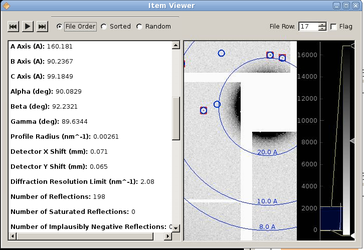

What about selections? DatView is based on selecting items, not parts of items, so you cannot select a part of the image plot. But, you can "flag" images using the check box in the top right corner. Remember that control panel for changing the histogram legends? Scroll down a little to the flagged items and try flagging a few items in the viewer:

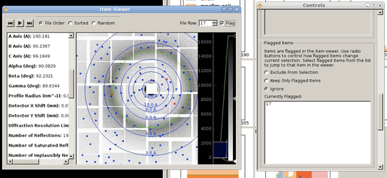

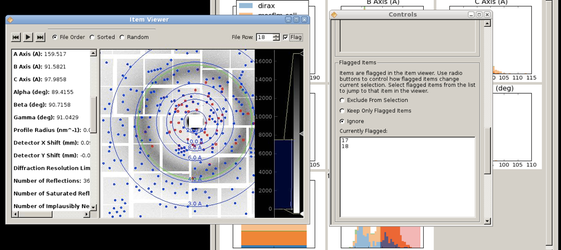

This doesn't initially have any impact on selections, because it is time consuming to update all plots on each selection and annoying if the next/previous buttons on the item viewer aren't consistent because flags keep changing. In general, it makes more sense to loop through the items normally making notes and then apply them at the end. So, from the control panel, we can set the selection to only include flagged items (that also match all other selections) resulting in 2 selected (notice the status bar):

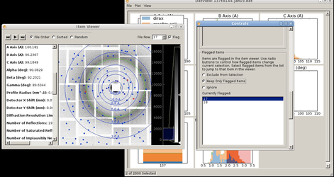

Or, if you were flagging bad ones, you can do the opposite and keep only non-flagged items (that also match all other selections) resulting in 497 (of the previously 499) selected:

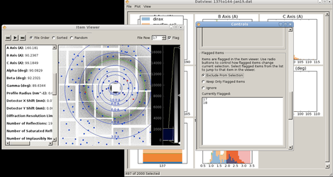

Clicking on a flagged item will jump the item viewer to that item.

That wraps up features associated with cxiview. Still interested? The next section covers the remainder of the options in the control panel.

## Control Panel

You've already seen 3 of the 6 controls in the Control Panel:

1. Sorting (see [Item Viewer](#item-viewer))
2. Histogram Legends (see [DatView](#datview))
3. Partitions
4. Flagged Items (see [Item Viewer](#item-viewer))
5. Limits
6. Filters

### Partitions

So, let's cover the three you haven't seen yet starting with partitions. Cell_explorer has options to toggle what's shown in the histograms based on the indexing method:

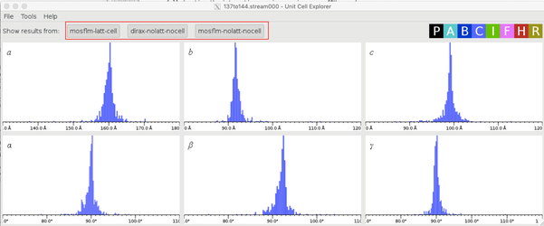

Well, you can do the same thing from DatView and it's called partitions because it breaks the overall dataset down into parts. Try activating partitions with the check box next to Partitions:

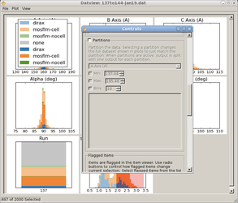

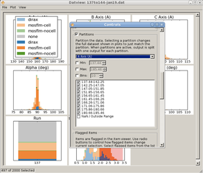

You'll notice this view is pretty similar to histogram legends except there is no color option. Looking closer at the list, you may also notice that there is an unchecked partition for anything that didn't have a number for that field or is outside the range you can set with the min and max options. Try changing partitions to match indexed by, since that one is easiest to see updates with given the current histogram legends.

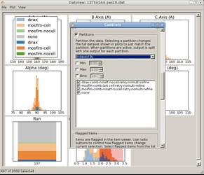

Now, you can toggle particular sets of data:

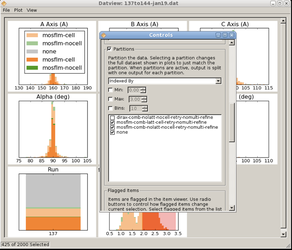

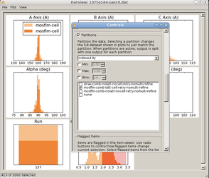

However, the main use of partitions is related to file export. If partitions are active, then the number of files output when selections are exported is equal to the number of partitions. So, if you want to bin a dataset into 3 different unit cells, instead of manipulating selections to save 3 different times, you can create a partition and save your selections once. Check out `datexport.py` in the [2019 manual](../DatView_Manual_and_Tutorial_2019.pdf) for more information on partitions.

For now, though, let's turn partitions off:


### Limits

And look at the next control in the panel. This controls the number of frames/patterns that are exported in each output file. If you have 500 selected but only want 50, you can take a random subset of 50 from the 500 or you can take the top 50 patterns according to the current sort order. This option is also described more in `datexport.py`.

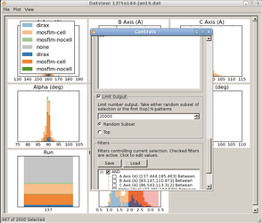

### Filters

The final item in the control panel is filters. You've already tried making selections on histograms, and if you've followed the tutorial you currently have a selection on the diffraction resolution limit that is active. Each selection that you make "filters" the data and is therefore a "filter" in the filter panel. Only patterns that match the current active filters are part of the selection. Looking at the panel, you can see that only the Diffraction Resolution Limit filter is checked. There will be a filter for each parameter involved in a plot since each plot can be used for selections.

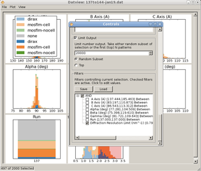

Try making the window a little bigger so you can see the whole line of each filter. The top level filter is an AND filter that means all child filters of the AND filter must match for something to be part of the selection. AND filters and OR filters are group filters that have children and control how the children are combined. You can add a filter to a group filter with the '+' button in the far right:

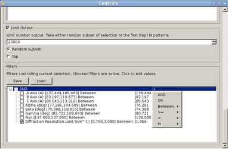

All the filters created by default are "Between" filters because a selection on a plot has a minimum and maximum. But what if you want to select a discontinuous region? For instance, suppose you want the low diffracting OR high diffracting but not the middle. First, you need an OR filter as a parent because no pattern is going to be both high AND low. Then you can add a less than and a greater than filter:

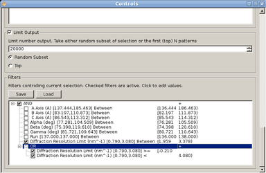

Right now the selection filter is still active so go ahead and uncheck that:

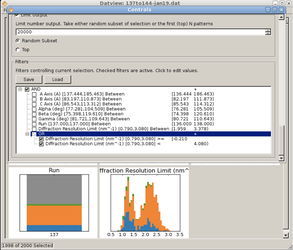

Now you can edit the cutoffs on your less than and greater than filter by clicking and typing. The default cutoffs are always min-1 and max+1 for any field (and so don't have any impact until you change them).

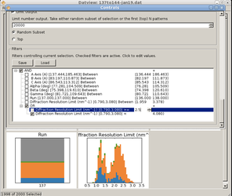

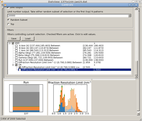

Now you can see from the plot that you have the high and the low selected, but not the middle region. However, looking at the number of selected and the Run, you realize you have way more patterns than you should. This is because any unknown values are set to "-1" and since the less than filter allows any value less than 1.5 it also allows all the unindexed frames which have a diffraction resolution limit of -1. You could fix this by adding a between filter on any value that only appears for indexed patterns, or adding a greater than -1 filter from the AND parent, but instead of those options try taking a look at the final filter type. From the AND parent, add an IN filter for Indexed By:

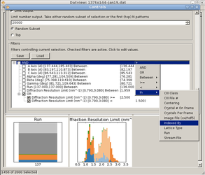

Indexed by is a categorical field so it doesn't always make sense to want continuous regions of the plot. An "IN" filter is only available for categorical fields and lets you select which ones you want to keep individually:

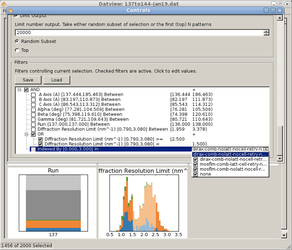

So, to remove any that have an indexing method of "None" you would uncheck "None" on the IN filter:

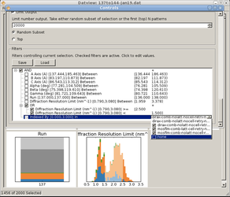

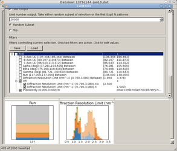

Filters can be saved as xml files and loaded from the two buttons on the control panel, and more details are in *Filters* in the [2019 manual](../DatView_Manual_and_Tutorial_2019.pdf).

That covers the control panel. For now, inactivate the filters to bring back the full selection. You may also need to set flags to ignore.

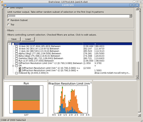

## Plots

So far, the only plots used have been histograms, but you may have noticed from the Plot menu that there are 4 other types of plots:


Each of the other plots has a dialog and opens in its own window.

### Scatter


The scatter plot dialog allows selecting three fields for the x axis, y axis, and color. You may notice that the fields are initially set to Current Sort Order, Cell Volume, and Diffraction Resolution Limit. These and all other combo boxes for fields (including those in the control panel) have initial values defined in the configuration file. You can edit them there for the plots you use most to save yourself some time. For now, click okay to get the default plot:


The good news is, you know that the current sort order (which you set in the [Item Viewer](#item-viewer) section of this tutorial) is working because the coloring of the dots goes from small to large and the first half is empty of dots where the diffraction resolution limit is "-1" because the patterns weren't indexable. But, it doesn't really make sense to have a scatter plot where the x axis is essentially the same as the color-by field. So, try changing the current sort order. Using "Image File" probably corresponds roughly to time order since each image was its own h5 file (and therefore has a unique name) and the time stamp is part of the name.


The plot might not have automatically updated for you. If it did not, you should use the right click menu to "Reset" the plot. "Reset" will regenerate the entire graph including refitting the axis to the current data. While you have the right click menu open anyway, it's a good time to look at the "Data" submenu which is available for all plots:


The default shows the full dataset semi-transparent and the current selection in full color, just like the histograms. Try changing it to draw selection only:


Which didn't change anything because nothing was selected. But now, if you make a selection:


The plot updates keeping only the orange/red dots that corresponded to high resolution patterns. You can bring it back to the default:


And compare that to showing the full dataset regardless of selection:


With colored scatter plots it is pretty difficult to see the differences between full color and semi-transparent, and in fact with too many points all the overlaps make scatter plots inconvenient, which is why 2D histograms exist. But, before getting to those, it's worth noting that you can select directly on the scatter plot as well:


And note that you can control options such as the marker, size, and colormap from the configuration file. But for now, clear the scatter plot selection so there is enough data to show 2D histograms:


### 2D Histograms


Two dimensional histograms are similar to scatter plots except the points are colored by the number of patterns that fall into that bin instead of by an external field. The initial plot, still impacted by the selection on the diffraction resolution limit histogram, looks like this:


You can change the data shown, like with the scatter plots, or simply clear the selection on the histogram.


The tool tips show the x and y bin edges on the first line and the count for that bin on the second line:


The right click menu has additional options. Note that setting the range is different than zooming/panning because it changes the min and max of the data actually shown on the plot. Also useful to know is that for any 2D plot you can zoom a single axis by scrolling over that axis instead of over the plot.


### Pixel Plot

Moving right along, the pixel plot was developed for data collected on a fixed target chip. In that case, each frame has a physical row and column number. The plot colors the pixel at the given row and column by the given field so you can see physical trends in the data. However, the sample data was not collected on a chip. In principle, you can use any two integers that uniquely identify a pattern such as image file (because all strings are mapped to integers) and event number for cxi files. But again, this data doesn't fit that. For a better example of this plot, see [Comparison Mode](#comparison-mode), but for now you can see the plot with the image file on the x-axis and the indexed by on the y axis:


And, because one axis is 2000 (for each file name) and the other only 4 (for the possible indexing methods) you can't see anything. To see something in this case, you can histogram the current sort order (histogramming the image file name is not recommended as that results in 2000 overlapping string labels that tend to take a while to draw) since we're currently sorting by image file (from earlier in this section with the scatter plots) and select 200 or so. Then, reset the pixel plot which will fit the axis to the current data:


As mentioned before, this plot really is designed for physical rows and columns that have similar dimensions so this was a pretty fake example. (For plates and raster scans, the 2026 version adds a plate / sample-position plot: see the [2026 manual](../MANUAL_2026.md#4-sample-positions-and-the-plate-plot).) The final plot, aggregated plot, is more universal.

### Aggregated Plot

The point of an aggregated plot is to plot statistics from groups of patterns. The y axis determines the statistic you are calculating over the group. By default, it is the average of the cell volume of the grouped patterns. You can select any field, use other aggregation such as median/min/max/count and optionally show error bars using standard deviation or min/max. The x axis sets the groups/bins. In this case, the indexed by method. You can have a second dimension of grouping with the "Lines" check box at the bottom. This interface is the same as the histogram legends interface (see [DatView](#datview)) and you can again change labels and colors.


The result is:


Where you can see that the highest diffraction resolution limit line (purple from 2.62-3.08) only has patterns from dirax and mosflm-comb-latt but not mosflm-comb-nolatt, and has a higher average unit cell volume from dirax than from mosflm.

## Comparison Mode

The normal view works great for looking at a dataset, but what if you want to see the effect of different parameters on the dataset? You could generate a table containing entries from both results and even include a column for which result a particular frame comes from. But it would be convenient if you could compare, frame by frame, the two results. That's what comparison mode does. To explore it, you'll first need some additional "results" to compare to each other.

Let's start by showing off file export. If you were optimizing the indexing for this dataset, you might take a subset of the patterns, say just the highest diffracting resolution ones, to optimize parameters. Try changing the sorting back to diffraction resolution limit and uncheck the ascending check mark (because the ascending check mark starts with the smallest diffraction resolution limits and you want the highest).


Next, scroll down to the limits, activate it, and set it to take 200 patterns sorting by top:


Now, you can export a dat file containing just the 200 frames with highest diffraction resolution limits:


That would look like this:


But, to index, you actually need a list file, so go ahead and save that out too:


And you'll notice the file names line up like they should:

```text
$ head -n 3 top200.lst
/bioxfel/data/2014/LCLS-2014-Cherezov-Jan-LA25/data/hdf5-dor/r0137-cgati40th4snr2px/data1/LCLS_2014_Feb02_r0137_091438_18f7e.h5
/bioxfel/data/2014/LCLS-2014-Cherezov-Jan-LA25/data/hdf5-dor/r0137-cgati40th4snr2px/data8/LCLS_2014_Feb02_r0137_092307_5b6b.h5
/bioxfel/data/2014/LCLS-2014-Cherezov-Jan-LA25/data/hdf5-dor/r0137-cgati40th4snr2px/data3/LCLS_2014_Feb02_r0137_091750_9c5a.h5
```

Now, the original stream file used integration radii 345 (`--int-radius=3,4,5`):

```text
$ head -n 3 137to144.stream000
CrystFEL stream format 2.3
Generated by CrystFEL 0.6.2
/gpfs/cfel/cxi/scratch/user/zatsepin/crystfel-0.6.2/install/bin/indexamajig -i split-events-137to144.lst000 -o 137-144/137to144.stream000 -j 80 -g refined-july20-137-144.geom -p DOR.cell --peaks=hdf5 --indexing=mosflm,dirax,mosflm-nocell-nolatt --int-radius=3,4,5
```

So, try a few other integration radii. In this example, 234, 235, 239, and 245. For each stream file, generate a corresponding dat file:

```bash
python datgen.py -o top200-234.dat top200-234.stream
python datgen.py -o top200-235.dat top200-235.stream
python datgen.py -o top200-239.dat top200-239.stream
python datgen.py -o top200-245.dat top200-245.stream
```

Now, you need to create the input for the viewer with the script `datcompare.py`. The unique identifier for each frame is the image file name (`ifile`) so that is passed to `--synccols`. You can use multiple fields for `--synccols` if needed (like `ifile event` for multi-event files). The `--alias` option is optional and allows you to specify names as they'll appear in the GUI. Otherwise, the full file name is used. The output is a numpy zipped file (npz) (see `datexport.py` in the [2019 manual](../DatView_Manual_and_Tutorial_2019.pdf) for information about the numpy file format for DatView). Then, the list of input files. You can directly launch the GUI with the result:

```bash
python scripts/datcompare.py --synccols ifile --alias 345 245 235 234 239 \
    -o intradcmp.npz top200.dat top200-245.dat top200-235.dat top200-234.dat top200-239.dat
python datview.py intradcmp.npz &
```

And you get a similar window as before, with 1,000 patterns (200 from each of the 5 dat files):


You have two new fields: Comparison Group and Comparison ID. Comparison group stores which dat file the frame came from. Comparison ID is an identifier for the unique synccol(s) used in the previous step. So, for this, all frames with the same comparison ID had the same ifile. You can use these fields in the normal drop down boxes, for example, to stack histograms:


Well, from a histogram perspective, there weren't very many differences. But, you now have other plots you can look at:


Try out the comparison scatter. In this plot, you pick a single field to plot by and the x and y axis are taken from different comparison groups so you can see how the parameters affected individual frames:


If there was no difference frame by frame, you would expect a straight diagonal line. Instead, you have several outlier frames. You can select on this plot, and then look at the frames in question. Selecting will get you 2 results per dot because each dot corresponds to two lines in the dat file.


You might notice, looking at the filters, that a new filter kind has appeared. The Pair Between filter enforces one condition on one comparison group and a second condition on another. Both conditions must match for that comparison ID in order for the frames to be kept.


But for now, unchecking the parent "pair" removes the filtering. While on the filter panel though, there are several other filter options unique to comparison mode. To explore them, first add some histograms to the main view so you can see the number of patterns in each group, the profile radius (a measure of how well the predicted reflections line up with the peaks) and the indexed by.


You can select the indexed by to see that some patterns weren't indexed under some conditions:


So, what if you only want patterns indexed under all conditions? You can use the "All Between" filter of comparisons on any parameter that is only available for indexed patterns:


Now, since 950 are left, you can assume that 50 individual results, or 10 frames total, were not indexable under some condition. There are other filters too. You could try determining which group is best by seeing where the minimum profile radius is:


Be aware with minimum / maximum filters that if all patterns have the same value the first comparison group is going to appear to have the minimum/maximum. So you may want to also include an "Any Different" filter to ensure that at least one pattern was different than the others. With that filter, be aware that a null value of "-1" is technically different from an indexed value even if all indexed frames have the same value, so it's often a good idea to have an "All Between" filter on as well.

The plots you're already familiar with can be useful in comparison mode as well. For example, an aggregated plot can create different lines for each comparison group across the range of comparison IDs:


So the x-axis is the 200 unique frames and the y axis the cell volume and there are separate lines for each condition. This is also a more applicable scenario for a pixel plot:


So you can look across a column to see how the cell volume changed for a particular pattern across the different conditions, or look across a row to see how the cell volume changes across frames.

In some cases, you may want actual numbers instead of plots. You may want to look into the `datstats.py` script:

```text
$ python scripts/datstats.py --partition datview_compare_group --average prorad --average reslim --count vol --average vol --std vol intradcmp.npz
datview_compare_group  average_prorad  average_reslim  average_vol  count_vol  std_vol
234                    0.00808883      2.50546         1449.31      196        203.491
235                    0.00836528      2.51067         1451.56      195        227.312
239                    0.00771224      2.47406         1448.54      192        284.633
245                    0.00824393      2.5098          1450.77      196        203.953
345                    0.00767405      2.52305         1451.12      200        16.1362
```

The partition switch is equivalent to the "lines" of the aggregate plot, resulting in separate output for each group. You can calculate a variety of statistics such as average, standard deviation (`--std`) and counts.

This concludes the tutorial. Check out the manuals for more details:

- [2019 manual](../DatView_Manual_and_Tutorial_2019.pdf): `datexport.py` (export options and formats for both the GUI and the script), `datgen.py` (creating tabulated data, including additional data), configuration files, filters, and scripts (including `datcompare.py` and `datstats.py` shown here).
- [2026 manual](../MANUAL_2026.md): installation, new `datgen.py` options, EIGER/HDF5 data, the plate plot and merging.
- `datplot.py -h`: generate figures from the command line.
